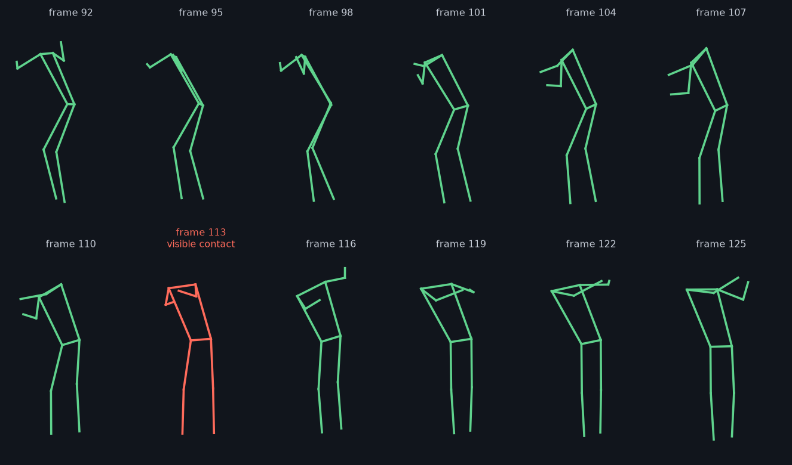

# swing-lab

Markerless baseball and softball swing analysis from a single video. Give it a
clip of one hitter and it produces an annotated skeleton video, metric plots, a
JSON report, and a plain-English list of findings with drills.

```
video -> pose estimation -> biomechanics metrics -> rules-based diagnosis
      -> annotated.mp4 + metrics.png + report.json + coaching.md
```

## Status

Early and experimental. Read this before trusting any output.

- **It has run on one real clip.** See below. Automated tests use synthetic
  keypoints, so they check the math and the pipeline, not accuracy on real swings.
- **Diagnosis thresholds are uncalibrated.** The values in
  `swing_lab/diagnose.py` are starting points.
- **Bat and ball tracking is scaffolded, not trained.** The code and training
  pipeline exist, but no weights ship with this repo. Without them, the attack
  angle is a hand-path proxy and rollover and timing calls stay low confidence.
- **The web app is for local use only.** It has no authentication or rate
  limiting. Do not expose it to a network.

## First real clip



Poses detected through one swing in
[this Pexels stock clip](https://www.pexels.com/video/baseball-player-hitting-the-baseball-5182770/)
by Tima Miroshnichenko. The video is not included in this repo.

| Check | Result |
|-------|--------|
| Hitter detected | 100% of 282 frames |
| Contact estimate | Frame 119. The ball visibly reaches the bat around frame 113, so the estimate ran about 5 frames late |
| Max hip-shoulder separation | 12 to 15 degrees, depending on the assumed frame rate and contact frame |

This shows the pipeline runs on real video. It does not show that the metrics are
accurate: this is one staged clip with no reference measurement. The file is
25 fps but was clearly filmed in slow motion at an unknown rate, so I ran it at
assumed rates of 120 and 240 fps and left speed numbers out. The camera faces the
hitter, so its attack angle isn't meaningful.

The clip exposed three bugs the synthetic tests had missed: 461 degrees of
separation, a contact call deep in the follow-through, and walking away counted
as head movement. All three are fixed and have regression tests.

## Setup

Tested on Python 3.13. `ffmpeg` is optional and makes annotated video
playable in browsers.

```bash
python3 -m venv .venv
.venv/bin/pip install -r requirements.txt
```

The default pose weights (`yolo11n-pose.pt`) are downloaded by Ultralytics on
first run.

## Usage

```bash
PYTHONPATH=. .venv/bin/python analyze.py data/swing.mp4

# Set the true capture rate for phone slow motion
PYTHONPATH=. .venv/bin/python analyze.py data/swing.mp4 --fps 240

# Save to a per-player library and compare against that player's baseline
PYTHONPATH=. .venv/bin/python analyze.py data/swing.mp4 --player Alex --save

# Local web app at http://127.0.0.1:5000
PYTHONPATH=. .venv/bin/python serve.py
```

Results go to `output/<videoname>/`. Videos, outputs, weights, and the player
database are gitignored.

**Frame rate matters.** Exported phone slow motion often reports 30 fps while
capturing at 120 or 240, which corrupts every time-based number. Pass `--fps` or
choose the rate on the upload form.

## Filming

Camera angle decides which numbers mean anything:

| Camera | Good for | Weak for |
|--------|----------|----------|
| Side-on (down the 1B/3B line) | attack angle, hand path, posture, head movement | hip and shoulder rotation |
| Face-on (from the pitcher or catcher) | hip rotation, hip-shoulder separation, sequence | attack angle, depth |

Use a fixed tripod, the same spot each time, 120-240 fps, and one hitter in frame.

## What it measures

- Hip and shoulder rotation, and hip-shoulder separation (face-on)
- Kinematic sequence: whether pelvis, torso, and hands peak in that order
- Attack angle from a hand-path proxy (side-on)
- Back-shoulder drop and head drift
- Estimated contact frame, from peak hand speed
- Hand speed in shoulder-widths per second, which stays comparable across camera
  distances and frame rates

## Known limits

- One camera gives 2D projections of 3D motion. It suits comparing a player to
  their own baseline, not lab-grade absolute numbers.
- Camera angle isn't detected. Attack angle only means something from a side-on
  camera, and rotation and separation only from a face-on camera.
- Contact is estimated from peak hand speed, which can land a few frames off.
  Use `--contact-frame` if you know the true frame.
- If the hitter is detected in under 70% of frames, the report shows a warning
  and every finding drops to low confidence. That cutoff is also uncalibrated.
- Rollover cannot be called confidently without bat tracking. Timing against the
  pitch and contact depth need ball tracking.

## Optional add-ons

- **Bat and ball models:** see [training/README.md](training/README.md), then
  pass `--bat-model` and `--ball-model`.
- **LLM coaching text:** set `SWING_LAB_LLM_BASE_URL`, `SWING_LAB_LLM_MODEL`, and
  optionally `SWING_LAB_LLM_API_KEY` to use any OpenAI-compatible endpoint,
  including a local one. Otherwise a templated report is used, and no data leaves
  your machine.

## Tests

```bash
for t in tests/test_*.py; do PYTHONPATH=. .venv/bin/python "$t" || exit 1; done
```

## How this was built

Written with substantial help from AI coding tools (Claude Code), with design
and review by the author.

## License

AGPL-3.0, see [LICENSE](LICENSE). The default pose model and framework come from
[Ultralytics](https://github.com/ultralytics/ultralytics), which is also
AGPL-3.0 and has its own terms for weights and commercial use.
